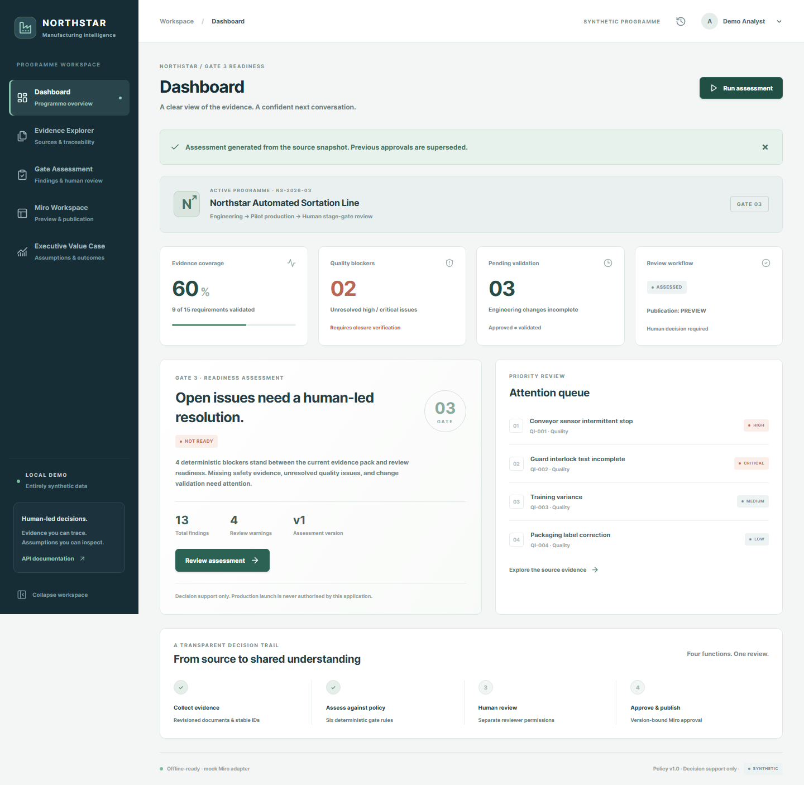

# Manufacturing Gate Copilot

A standalone Manufacturing Quality & Stage-Gate Review Copilot for the **fictional Northstar Automated Sortation Line**. All records are synthetic. Readiness supports human review; it never authorises production.



Includes a React/TypeScript interface, FastAPI API, SQLite persistence, six deterministic rules, revision-aware evidence and verified quotations, a seven-section board scene, local HTML preview, version-bound approvals, idempotent mock publication, Decimal value scenarios and a ten-section executive Markdown report.

## Run locally (PowerShell)

Prerequisites: Python 3.12 and Node.js 22+ with npm. Initial dependency installation needs network access. The default application runs without credentials or network access.

From this project directory:

```powershell
python -m venv .venv
.venv/Scripts/python.exe -m pip install -r backend/requirements.lock
.venv/Scripts/python.exe -m pip install --no-deps -e backend
npm.cmd ci --prefix frontend
npm.cmd run build --prefix frontend
.venv/Scripts/python.exe -m uvicorn app.main:app --app-dir backend --host 127.0.0.1 --port 8000
```

Open **http://127.0.0.1:8000**. The UI creates a labelled Analyst demo session. Choose Reviewer and Publisher from the identity selector for their separate permissions. The server issues an HttpOnly session cookie; role headers have no authority.

Subsequent runs: `./scripts/start.ps1` or the uvicorn command above. Bind only to loopback. Production mode deliberately refuses startup until a production identity provider is implemented. One application process is supported.

For frontend development, leave the backend running and run `npm.cmd run dev --prefix frontend` in another terminal. Open http://127.0.0.1:5173. Vite proxies `/api` to port 8000. Use the same hostname consistently for cookies.

Offline API reference: http://127.0.0.1:8000/docs. Machine-readable contracts: `/openapi.json`.

`.env.example` documents settings; it is not automatically loaded. Set environment variables in the launching shell. Defaults work without an `.env` file. SQLite is created at `data/copilot.sqlite3`; fixtures load only into an empty repository. Restarting preserves assessments, approvals, audit and mappings. Memory-only sessions expire after eight hours.

## Demonstration

1. As **Analyst**, run an assessment. Expect NOT_READY, 60% coverage, four blockers, five evidence-insufficiency findings and four warnings.
2. In **Evidence Explorer**, search `DOC-004`. Inspect both active revisions and expand verified quotations.
3. In **Gate Assessment**, inspect rule IDs and citations. As **Reviewer**, enter a rationale and acknowledge review. Unresolved risks remain unresolved.
4. In **Miro Workspace**, inspect the local preview. As **Publisher**, request approval, approve the version and explicitly publish to mock.
5. Inspect the 56 managed mappings. Republish: zero creates, zero updates, 56 unchanged items.
6. In **Executive Value Case**, inspect all assumptions and export the report. The base case models 238.08 hours/year and GBP 13,075.20 recurring annual net benefit; these are not achieved savings.
7. The history icon opens the audit trail. A new assessment or changed review supersedes previous approval.

See [demo script](docs/demo-script.md), [generated executive readout](docs/executive-readout.md), [standalone preview](docs/board-preview.html) and [fictional sprint charter](docs/validation-sprint.md).

## Verify

Stop any manually running server on port 8000 first. Browser tests create their own isolated SQLite file and server.

```powershell
New-Item -ItemType Directory -Path .test-tmp -Force
.venv/Scripts/python.exe -m pytest -q -c backend/pyproject.toml backend/tests --basetemp .test-tmp/local-run
.venv/Scripts/python.exe -m ruff check backend/app backend/tests
.venv/Scripts/python.exe -m mypy --config-file backend/pyproject.toml backend/app
npm.cmd run lint --prefix frontend
npm.cmd run build --prefix frontend
npx.cmd --prefix frontend playwright install chromium
npm.cmd run test:e2e --prefix frontend
```

After installing Chromium, `./scripts/check.ps1` runs all checks. Use a fresh temporary path if Windows retains a lock from an earlier test. Actual results: [delivery status](docs/delivery-status.md) and [milestone log](docs/milestones.md).

## Architecture and inventory

| Folder | Contents |
|---|---|
| `backend/app/domain` | Pydantic entities and distinct status enums |
| `backend/app/persistence` | SQLite JSON repository, durable publication claim and audit |
| `backend/app/services/evidence` | Fixture/JSON/Markdown ingestion, lookup and quotation verification |
| `backend/app/services/assessment` | Six deterministic rules and readiness precedence |
| `backend/app/services/ai` | Template and opt-in local Ollama explanation providers |
| `backend/app/services/miro` | Scene, preview, mock/REST adapters and journal |
| `backend/app/services/value` | Decimal financial scenarios |
| `backend/app/main.py` | Versioned API, demo identity/permissions, frontend hosting |
| `backend/tests` | Unit, integration and adversarial/golden evaluations |
| `frontend/src` | Five typed React views, API client and components |
| `frontend/e2e` | Chromium desktop workflow and mobile checks |
| `fixtures/northstar` | 15 requirements, 10 document IDs/11 revisions, 8 issues, 5 changes, 8 actions, KPI baseline, policy and manifest |
| `docs` | Architecture, domain/security models, Miro runbook, charter, reports and screenshots |
| `scripts` | Start/check helpers, fixture generation, ingestion and export |

Read [architecture](docs/architecture.md), [domain model](docs/domain-model.md), [security](docs/security-model.md) and [master specification](SPEC.md).

## Optional integrations and limits

**Mock Miro** is fully local and tested. A PUBLISHED mock record does not mean a real board exists. The **live REST adapter** and remote read-back verification are implemented and transport-tested, but real Miro publication is awaiting your authorised test board and OAuth token. Activation requires human authorisation, `MIRO_MODE=live`, `ALLOW_LIVE_MIRO=true`, a server-side authorised `MIRO_OAUTH_TOKEN` and existing `MIRO_BOARD_ID`. See [Miro integration](docs/miro-integration.md). No live request was made.

**AI** defaults to deterministic templates. Local Ollama with `llama3.2:1b` is now installed and validated with actual baseline/injection inference and a real-browser check. Run `./scripts/start.ps1 -Ollama` to opt in. It uses localhost:11434, a configurable 30-second request timeout (1–60 seconds), validated finding-ID/question plans and visible fallback reasons. The server renders facts/citations; the model cannot modify readiness or permissions. Successful results are cached for the exact assessment/model. See [live validation results and commands](docs/live-integration-validation.md).


**Docker:** `docker compose up --build` is provided and binds host loopback. Private container clients are permitted only by that compose configuration. Docker was unavailable on this machine, so this path is unvalidated. The native setup is tested. Never expose demo identity publicly.

## Local data

Fixtures are versioned and source revisions hashed. `scripts/generate_fixtures.py` recreates fixture files, without resetting SQLite. To start fresh without deleting work, set a different `DATABASE_PATH`. `scripts/export_demo.py` generates the standalone report/preview from an in-memory fixture database.

Local ingestion example, synthetic files only:

```powershell
.venv/Scripts/python.exe scripts/ingest_evidence.py path/to/source.md --id DOC-005 --revision B --title "Synthetic instruction revision" --requirement REQ-005 --requirement REQ-015 --status PARTIAL
```

Existing policy document IDs are picked up on the next assessment. Different active revisions conflict deliberately; there is no retirement UI. New document IDs must also be linked by a controlled policy import; the CLI does not rewrite requirements.

No Data Room Cited runtime dependency or copied source is included. Its citation helper was inspected read-only; no explicit reuse licence was found, so this implementation was written independently. The application runs locally; external deployment and live Miro publication require separate authorisation.

Recommended v1.1: production SSO, transactional workflow/migrations, controlled revision retirement, multi-process concurrency, live OAuth/drift checks, guided ambiguous-write recovery, accessibility audit and measured customer validation of value assumptions.
