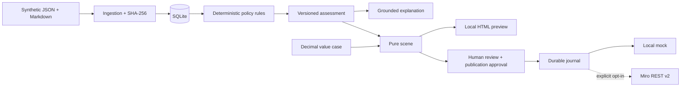

# Architecture

This independent application uses the current directory as its root, avoiding a redundant nested repository directory.

React renders five views and submits commands. FastAPI authenticates a server-issued demo session, checks role permissions and validates Pydantic contracts. SQLite stores entities as JSON under `(kind,id)` primary keys. Assessment, scene generation and financial calculation are pure domain functions. Explanation has no mutation interface.

## Evidence and readiness

Ten logical documents have eleven active revision files. Exact ID retrieval returns all revisions; lexical search is deterministic. No vector store is required. References bind document/revision, paragraph location, whitespace-normalised quotation and SHA-256. The frozen source snapshot includes policy, requirements, evidence, issues, changes and actions. Assessments increment project version and supersede old approvals.

Only mandatory requirements with fully validated, linked and uncontradicted evidence count toward coverage. Partial/missing/conflicting evidence counts zero; every listed source is required. All fixture requirements are mandatory.

Precedence: blocker → NOT_READY; otherwise assessment-preventing gap/conflict → INSUFFICIENT_EVIDENCE; otherwise non-blocking work → CONDITIONAL_REVIEW; otherwise READY_FOR_REVIEW. Expected classifications are assertions in tests, never engine inputs. Synthetic policy records define criticality/criteria, not the model.

## State and publication

Assessment is DRAFT before calculation, ASSESSED when persisted, REVIEWED after human input. There is no persisted draft editor. Workspace: PREVIEW → APPROVAL_PENDING → APPROVED → PUBLISHING → PUBLISHED, with FAILED and superseded approval support. Approval binds assessment ID/version, scene hash, actor, destination and time. Changed source, assessment, review or scene prevents reuse. CHANGES_REQUESTED cannot progress to approval.

A mutation journal persists STARTED before outbound execution and SUCCEEDED/FAILED/AMBIGUOUS afterwards. Mode+board+stable key maps to remote ID/payload hash. Unchanged items retain IDs; changed items update; new keys create. No deletion occurs; stale managed objects are reported. The fixture has 41 content items, seven frames and eight connectors.

A persistent SQLite publication claim prevents concurrent publication. A crash leaving PUBLISHING or STARTED intentionally requires recovery. This is a single-process local MVP, not a multi-worker service. See the Miro runbook.

Native runtime builds React once and serves it from FastAPI:8000. Vite:5173 proxies `/api` during development. Docker follows `/app/backend`, `/app/fixtures`, `/app/frontend/dist`; that runtime is unvalidated here. Logs include correlation ID, method/path/status and exception class only. Audit stores actor/transition/provider status without credentials. Local API documentation is generated from OpenAPI without external scripts.
